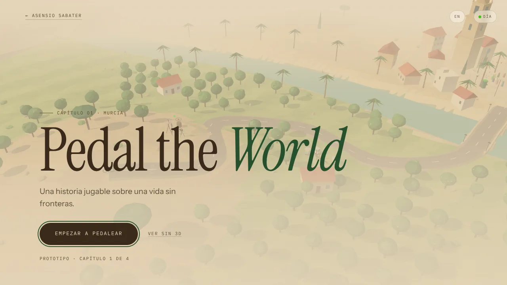
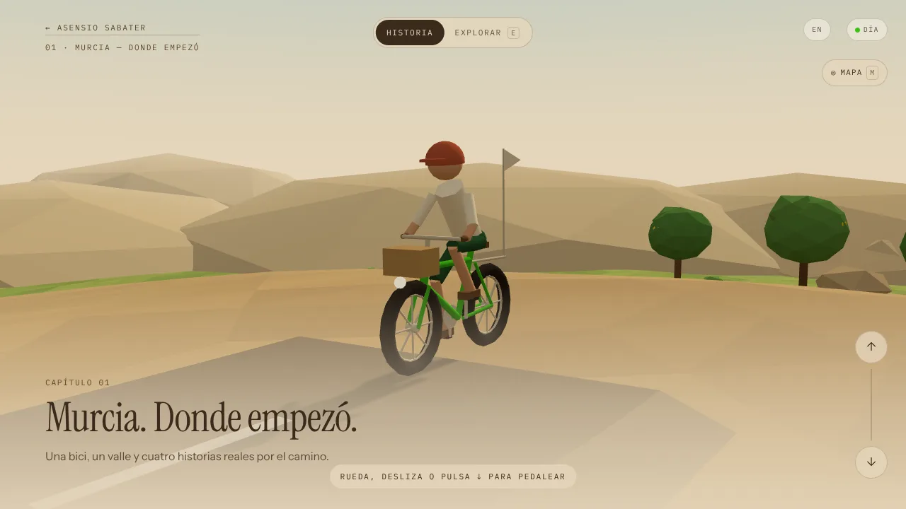
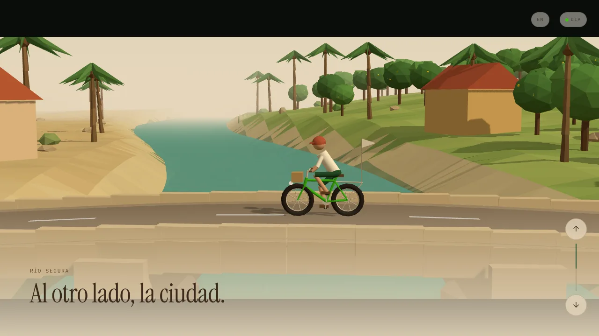
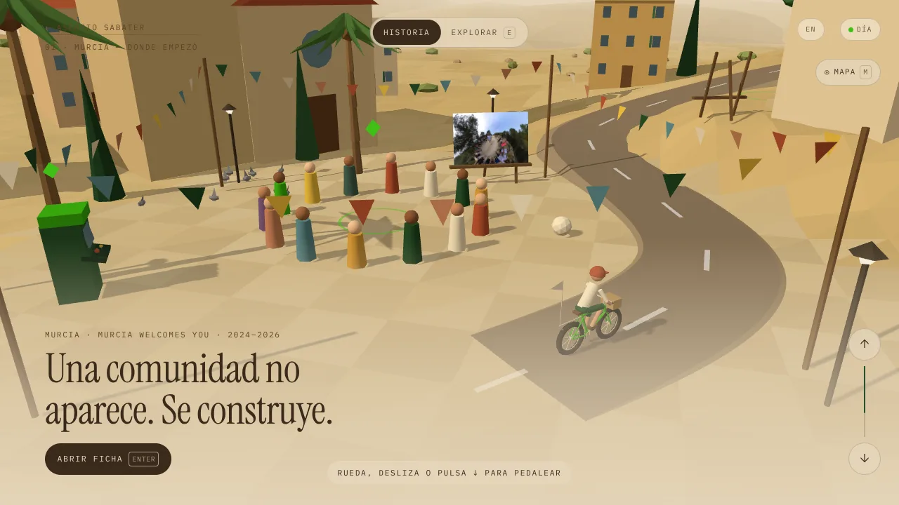
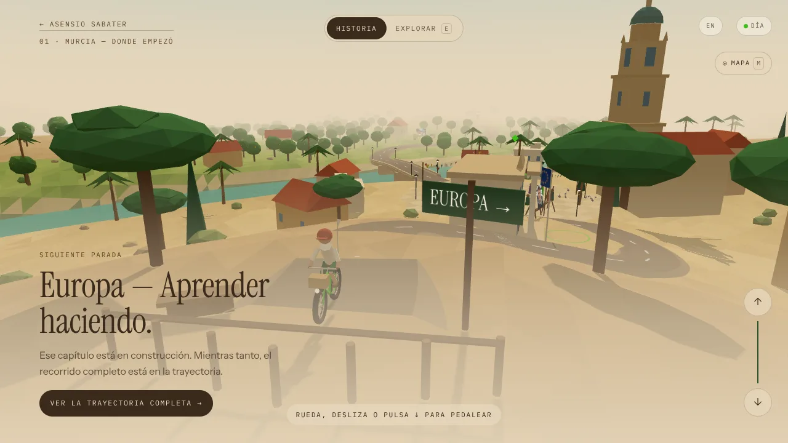
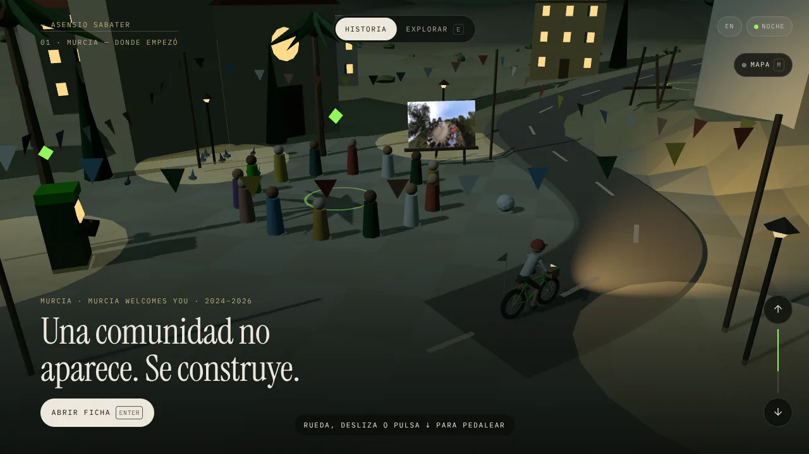
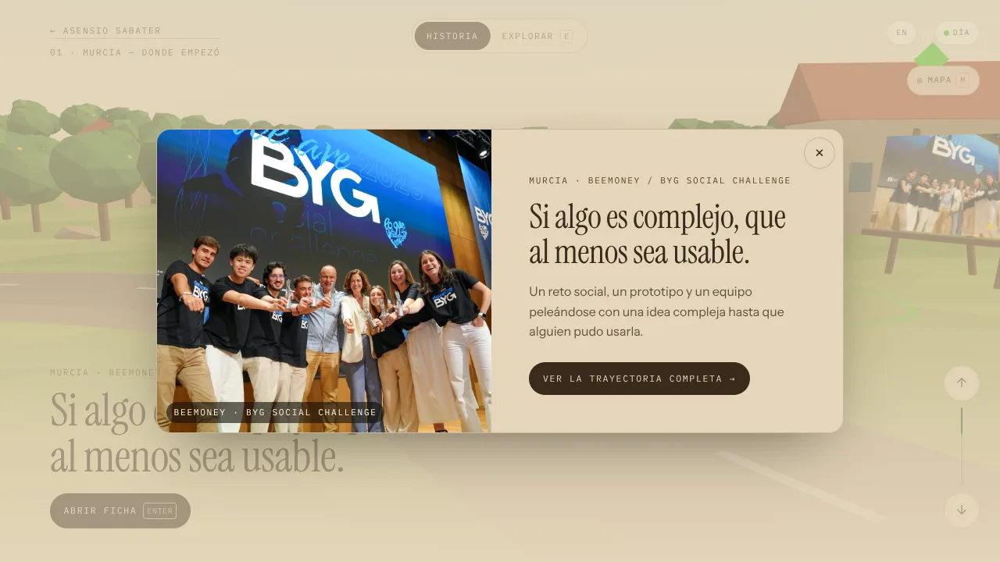

# Pedal the World — vertical slice

Experimental branch `claude/pedal-the-world`. Route: `/world/`. Not merged, not deployed.

A playable story about a life without borders. This slice is **Chapter 1 — Murcia**: one
finished-looking scene, a bicycle you can ride, and four real stories on the way.



| | |
|---|---|
|  |  |
|  |  |
|  |  |

All images are real captures of the running build (headless Chromium, 1280×720).

## Run it

```bash
npm install
npm run dev        # http://localhost:5173/world/
npm run build && npm run preview   # http://localhost:4173/world/
```

Useful query flags: `?stats` (live FPS / draw calls / triangles / load time), `?plain`
(the page without 3D), `?nowebgl` (forces the fallback path), `?autostart`.

## Art direction

- **A hand-made diorama of the valley, not a map.** The huerta with lemon trees in rows,
  the Segura, a stone bridge, a plaza with a bell tower, a mirador on the northern hill.
  Geography is evocative, not surveyed; the tower is inspired by a baroque bell tower but
  its proportions are invented.
- **The site's own palette, lit.** The horizon and fog are the site's paper (`#e5d6bb`),
  so the world dissolves into the page. Terracotta, lime-wash walls, orchard greens. The
  one saturated colour is the signal green — on the bike frame and the story beacons.
  Night theme = the site's night theme: moonlight, lit windows, lamp pools, a headlight.
- **Editorial interface.** Instrument Serif captions set low like subtitles, mono labels,
  no panels, no dashboards. The words painted on the tarmac ("MURCIA", "¡VENGA!",
  "SEGURA", "¡ÁNIMO!") borrow from how fans paint mountain roads on race day.
- **Restraint.** No particles, no bloom, no glow. Ambient life is small and specific:
  wind in the canopies, glints on the river, bunting, bees at the hives, pigeons.

## How it is built

Everything is original and generated in code — no downloaded models, textures or
audio. Blender was not available in the build environment, so assets are procedural
low-poly geometry (the kit merges them into a handful of meshes with vertex colours).

```
world/index.html        Cover (plain HTML, paints before any JS), HUD, card, menu,
                        and the plain index (no-JS default / no-WebGL fallback).
src/world.js            Page shell. No Three.js. Cover, HUD wiring, cards, menu/minimap,
                        touch controls, settings, WebGL detection, error fallback.
src/styles/world.css    Cover, HUD, card, menu, plain index, reduced motion.
src/world/game.js       Engine (lazy chunk): renderer, modes, input, physics, camera,
                        quality tiers, audio, context-loss recovery, stats.
src/world/murcia.js     The chapter: height field, route, road, bridge, town, vegetation,
                        story sets, ambient life, lighting, day/night, camera shots.
src/world/bike.js       The bicycle and rider.
src/world/kit.js        Geometry batching, noise, PRNG, maths, canvas text textures.
```

**Engine ↔ chapter contract.** The engine knows nothing about Murcia. A chapter returns
`heightAt`, `groundAt`, `nearest`/`pointAt` (the route), `colliders`, `pois`, `beats`,
`shots`, `update`, `setTheme`, `dispose`. Chapters 2–4 are new modules against the same
contract; the engine does not change.

**One world, two modes.**
- *Story*: the bike rides the route spline. Wheel / drag / arrows / Space / the ↑↓ buttons
  move it; the camera interpolates between authored shots (`shots` in `murcia.js`). The
  bridge crossing is the cinematic moment: long lens, profile shot, letterbox.
- *Explore*: same bike, same place, arcade physics — acceleration, drag, off-road drag,
  slope gravity, speed-dependent steering, hop, circle colliders, falls.
- Switching (button or `E`) keeps position: Explore → Story glides the bike back onto the
  nearest point of the route; Story → Explore simply hands over the handlebars.

**The bike.** Wheel spin from distance travelled; cranks turn only while pedalling
(it freewheels); legs use two-bone IK onto the pedals; arms follow the bars; lean from
steering × speed; pitch from the slope under both wheels; a sprung body that reacts to
landings and slope changes; a pennant that trails with speed; a basket that fills with
the lemons you collect.

**Recovery.** Riding into the river, leaving the valley or being stuck for 1.6 s fades and
puts you back on the road. "Volver a la ruta" (`R`) is always available in Explore.

**Controls.** Keyboard: arrows/WASD, Space (hop / next beat), Enter (open card), E (mode),
M (map), R (return), B (bell), Esc (close). Touch: drag to pedal in Story; virtual stick +
hop/bell buttons in Explore. Map panel: fast travel to the seven stops, chapter list,
settings (sound, reduce motion, light graphics), links to trajectory / Playroom / contact.

**Content.** Card and caption text is the already-published trajectory copy
(`traj.ch1/ch6/ch7/ch9` in `src/i18n/dict.js`), ES/EN. Two role lines were added from
verified facts: MWY "Founder & Project Coordinator · Jan 2024 – Jan 2026" and European
Projects Office "Intern · Feb – Mar 2025". Divulgalo and BeeMoney carry no role or date
because none is verified. Chapters 2–4 are listed as "en construcción", nothing more.

**Secrets.** Bump a lemon tree → a lemon drops; ride over it → it goes in the basket.
Ring the bell (`B`) near the tower → the tower answers and the pigeons scatter. Ride into
the circle of people → they jump. A football in the plaza. The arcade cabinet in the plaza
is the door to the existing Playroom (`/games/`).

## Performance and loading

- Cover is static HTML/CSS; the shell script is 4.9 kB gz. Three.js + engine + chapter is
  one lazy chunk requested after the cover is on screen.
- The world builds in stages with real progress on the start button; "Empezar" enables
  only after the first frame has rendered.
- Photo boards in the world load by proximity (< 55 m); card photos load on open.
- Quality tiers (DPR 1.25–2, shadow map off / 1024 / 2048) chosen from the device tier,
  with a one-way automatic step-down if the frame rate stays under 40 fps.
- Rendering pauses when the tab is hidden; everything is disposed on `pagehide`.
- WebGL context loss pauses and resumes; any boot error falls back to the plain index.

### Measured (this build)

| | |
|---|---|
| Shell JS (`world-*.js`) | 12.1 kB / 4.7 kB gz |
| Shared i18n + theme chunk | 24.4 kB / 8.9 kB gz |
| World CSS | 15.0 kB / 3.8 kB gz |
| Engine chunk (Three.js + game + chapter + bike) | 602.6 kB / 159.5 kB gz |
| Fonts on this page (4 woff2) | 75.9 kB |
| First contentful paint (cover), local preview | ~190 ms |
| Engine import + world build to first frame, local preview | 460–550 ms |
| JS heap after load | ~32 MB |
| Scene | ~199k triangles drawn with shadows, ~123k without; 66–100 draw calls per pass |
| GPU objects | 52 geometries, 12 textures |

**Not measured: real frame rate.** The build environment has no GPU; Chromium rendered
with SwiftShader (software), where the scene runs at 4–20 fps depending on tier. That
number says nothing about real hardware, so no FPS claim is made here. Use `?stats` on a
real phone and laptop to get it. Load times above are from a local server on the build
machine, not from production or a throttled network.

## Tested (automated, headless Chromium, software GL)

Scripts in `tests/world/` (need Playwright; see the header of `lib.mjs`). 33 checks pass:

- Story: wheel advance, key reverse, next-beat button, caption content.
- Cards: open with Enter / tap, photo and copy, close with Esc, focus restored.
- Explore: acceleration, steering, hop, collision with a tree (pushed out, not through),
  lemon drops and is collected, river → respawn on the road, proximity prompt.
- Map: opens with M, fast travel. Mode switch both ways. ES ↔ EN on the HUD.
- Mobile (iPhone 13 emulation): drag to pedal, card by tap, stick + buttons, hop,
  no horizontal overflow.
- Reduced motion honoured from the OS (no intro swoop, calm mode on).
- `?nowebgl` and `?plain`: plain index with four entries, canvas hidden, engine chunk
  never downloaded. No console or page errors in any run.

Also run: `npm run build` (ok), `npm test` (32/32), ESLint on the new files (clean; the
22 errors `npm run lint` reports are pre-existing in `tools/blog/`).

## Not tested / pending

- Real devices: frame rate, thermal behaviour, touch feel, iOS Safari audio unlock.
- Screen-reader pass. The canvas is `aria-hidden`; the same content is in the cards and
  the plain index, but it has not been tried with VoiceOver / NVDA.
- Camera occlusion in Explore: trees can pass between camera and bike. Story sight lines
  are kept clear at build time; Explore has no occlusion handling yet.
- Collision is circles only; long buildings are approximated by several circles.
- No audio beyond the bell. No music.
- The start of the route is plainer than the plaza; it wants one more landmark.
- Chapters 2–4, chapter-to-chapter transitions and direction-based preloading of the next
  chapter do not exist yet (there is only one chapter to load).
- Role and date for Divulgalo and BeeMoney need confirming before they can be shown.
- University of Murcia International Office (Jun–Sep 2024) is verified but not yet a stop.
- Deploy: `/world/` is a new directory route. The VPS Caddy config must resolve
  `/world/` to `world/index.html` the same way it does for `/trajectory/` and `/games/`.
- The home page has a small "Pedal the World" link on this branch only.
